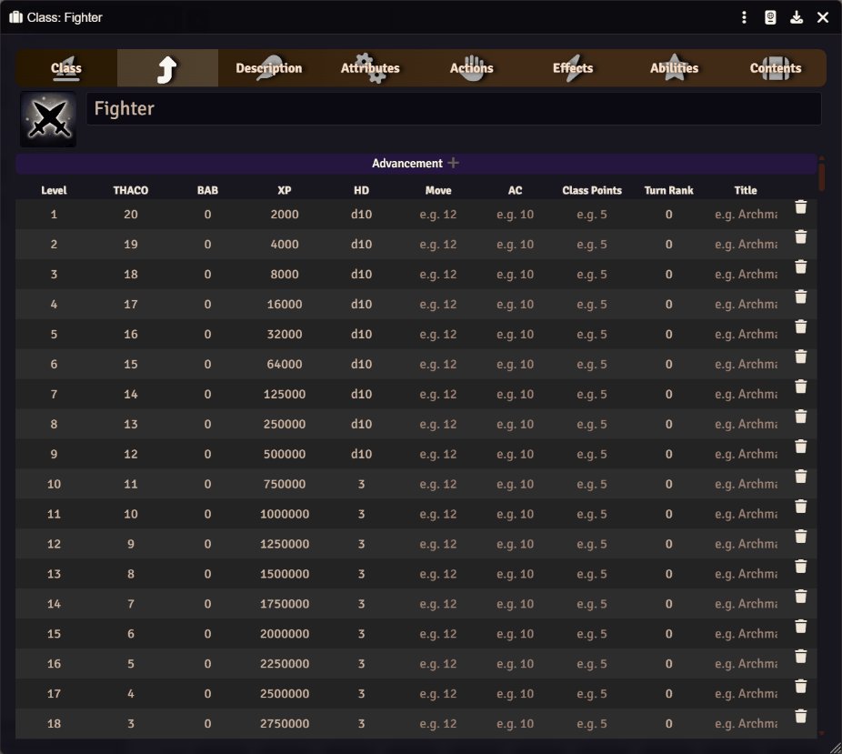
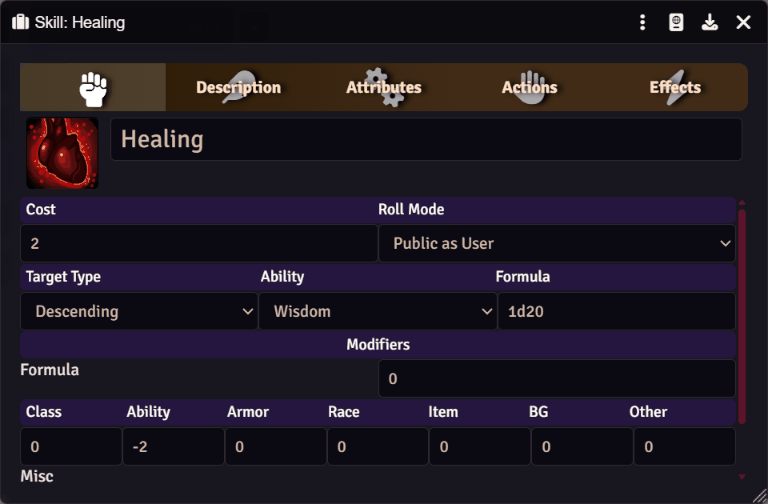
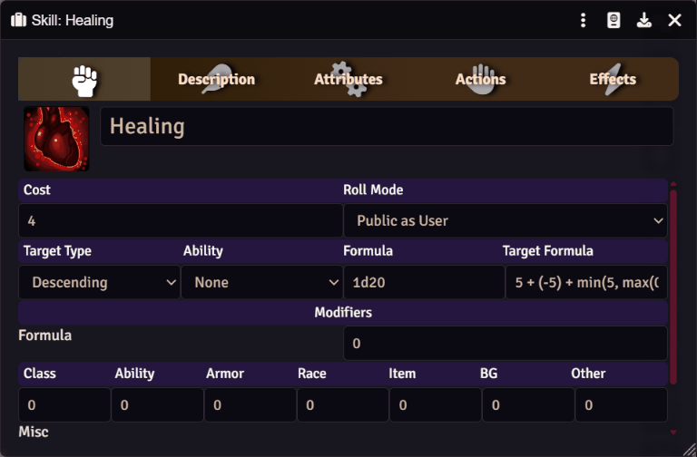
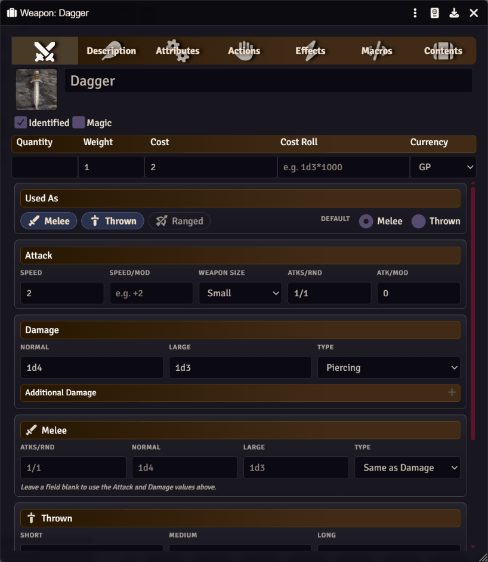
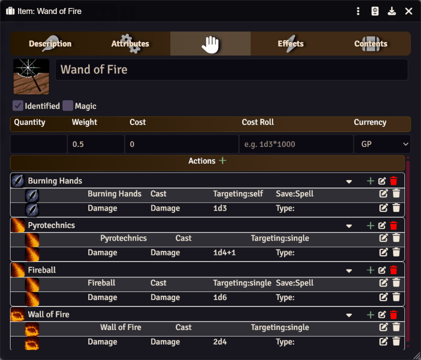
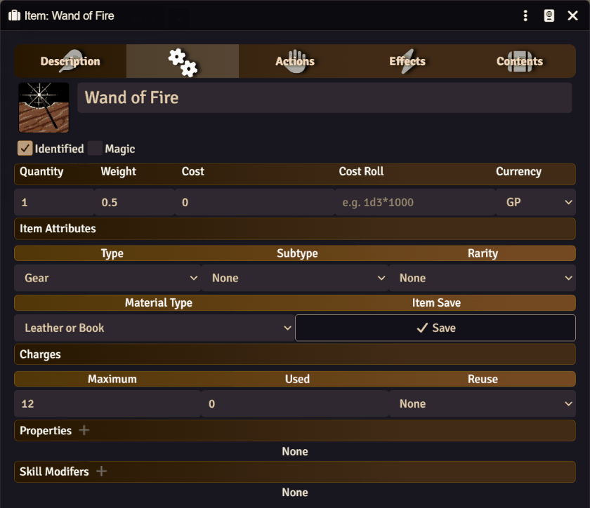

# User guide

What the script puts in the `adnd2-compendium` module, and what it leaves empty. For how
ARS itself works, see the ARS documentation.

## PHB or Skills & Powers

Both rule sets are in the module side by side; there is no setting to choose one.

- **Classes**: the classic classes are in the *Warriors*, *Priests*, *Rogues*, *Wizards* and
  *Psionicists* folders, the Skills & Powers versions, marked **(CP)**, in *Classes (CP)*.
- **Nonweapon proficiencies**: *Nonweapon Proficiencies (PHB)* and *Nonweapon Proficiencies
  (S&P)* folders. A proficiency found in both books is there twice, with the same name.
- **Character kits** grant the proficiencies of their own book, PHB or S&P.

### Creating a PHB character

1. Set the ability scores on the character sheet.
2. Drag a race from the *Races* folder. It grants the racial abilities and skills.
3. Drag a class from the *Warriors*, *Priests*, *Rogues*, *Wizards* or *Psionicists*
   folder. It grants the class abilities as the character reaches their level, and the
   rogue skills of thieves and bards.
4. Optionally, drag a kit from *AD&D 2e Character Kits*. It grants its proficiencies.
5. Drag weapon proficiencies from *AD&D 2e Weapon Proficiencies* and nonweapon proficiencies
   from *Nonweapon Proficiencies (PHB)*. ARS counts the slots used and available.

### Creating a Skills & Powers character

1. Set the ability scores. ARS has no sub-abilities: use the main scores.
2. Drag a race from the *Races (CP)* folder. It grants only the skills every race has; its
   description gives the race's character point budget. Buy racial abilities from the
   race's folder in *Racial CP Abilities*.
3. Drag a class from the *Classes (CP)* folder. It grants no ability; its description gives
   the class's character point budget. Buy class abilities from the class's folder in
   *Class CP Abilities*. For thieves and bards, buying a thief skill there grants the skill.
4. Spend the remaining points on nonweapon proficiencies from *Nonweapon Proficiencies (S&P)*
   and on weapon proficiencies.

The cost of each ability is in its name, for example *Hit Point Bonus (10 CP)*, and the
cost of each S&P nonweapon proficiency in its **Cost** field. ARS does not count character
points: keep track of them yourself. The proficiency slots ARS shows are the PHB ones.

Not in the module: S&P traits and disadvantages, and the character point cost of weapon
proficiencies.

## Classes

Filled from the CD-ROM, for each level:

- **THAC0**, **XP** (experience needed for the next level) and saving throws.
- **HD**: the class Hit Die up to the last Hit Die level, then the flat hit points gained per
  level. Where `CLASS.DAT` disagrees with the PHB experience tables, the PHB value is used.
- **Class Points**: the rogue skill points of thieves and bards.
- **Turn Rank**: for the classes that turn undead.
- Spell slots and caster level.

Also filled: the weapon and nonweapon proficiency slots and the non-proficiency penalty
(checked against PHB Table 34), and the class abilities with the level they are gained at.

Levels go beyond 20th: the module imports *High-Level Campaigns*.

Left empty: **BAB**, **Move**, **AC** and **Title**, which AD&D 2e classes don't use.

## Nonweapon proficiencies

**PHB**: the ability is set, and the book's check modifier is in the **Ability** field of
the *Modifiers* row.

**Skills & Powers**: no ability is set. The **Target Formula** computes the score: the
initial rating plus the S&P ability modifier (Table 44) of the better of the listed
abilities. ARS has no sub-abilities, so the main ability score is used.

## Weapon proficiencies

Filled: cost, speed, the weapon group familiarity they grant (S&P), and the hit and damage
bonuses of specialization.

Left empty: **Applied To**. It lists the character's own weapons; ARS offers to fill it when
a weapon is added to a character who has the proficiency.

## Weapons

Filled: the modes the weapon can be used in (melee, thrown, ranged), damage against small and
large targets, damage type, speed, size, attacks per round, the ranges of thrown and
missile weapons, and for magic weapons the attack and damage bonus and the magic potency
(the "+N" needed to hit some creatures).

## Spells

Filled: level, school or sphere, range, components, duration, casting time, area of effect
and saving throw, plus a **Cast** action (and a damage or healing roll when the spell has one).
Some spells have extra actions:

- **Area**: places the template of the area of effect (circle, cone, line, square), with the
  spell's range shown. 128 spells.
- **Auras**: an effect whose area follows the token and applies to whoever is inside —
  Chant, Prayer and Recitation (bonus for allies, penalty for enemies), Protection From Evil
  and Good 10' Radius, the globes of invulnerability (immunity to spells of the listed
  levels), Silence 15' Radius (silence status), and the shells and spheres (area shown only).
  Apply it to the caster, or to the creature the spell is cast on.
- **Effects**: Protection From Evil and Good on the creature touched; Mirror Image and
  Stoneskin, whose number of images or blocked attacks is rolled when the effect is applied
  and goes down with each attack.

Left empty: every other spell effect (charm, hold, sleep, light and darkness…). The GM
applies them.

## Magic items

Filled, as actions:

- **Use / Drink / Read / Activate** for consumables and devices. Drinking a potion uses it up.
- **Spell powers**: the spells an item can cast, as copies of the spell, with the item's
  limit: charges from the item, uses per day or per week, or the item used up.
- **Heal and damage** actions for items that heal or deal damage without a spell (healing
  potions, ring of the ram, robe of stars…).
- **Strikes that spend charges** for the staves and rods that need them (staff of striking,
  staff of power, rod of smiting…): an attack that uses the charges, then the damage roll.

Every magic item has its **Magic** box ticked.

Left empty:

- **Charges.** Set them when the item is found, in the item's *Attributes* tab (**Maximum**
  and **Used**). Until then, the powers that cost charges are greyed out.
- **Level** (next to XP, GM only). The caster level of the item's spell powers: their
  duration uses it. Left at 0, the effects they apply have no duration.

  

- **Passive effects** of worn items (bonuses to AC, saving throws, ability scores…) and the
  temporary effects of potions. Exception: the cloak of displacement (and the displacer
  beast) make the first attack of each opponent miss, as long as the cloak is equipped.
- No action for items that summon a creature, for flying and movement items, or for the
  necklace of missiles (the strength of its missiles is rolled per necklace).
